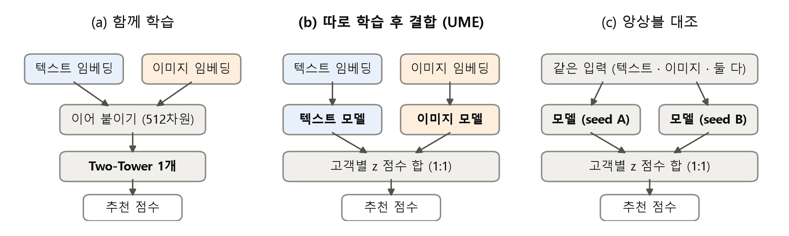

# 논문 초안 v0.9 (제출용)

> 3성하이닉스 제출용 초안 · 2026-10-26 · 참고문헌 원문 확인 완료 · 10차 결과 반영

---

# 패션 추천에서 이미지를 어떻게 쓸 것인가: 텍스트와의 결합 방식과 이미지 인코더 선택

김유환 · 김형우 · 김광석 (서강대학교)

## 요약

멀티모달 추천 모델이 이미지를 거의 활용하지 못한다는 보고가 있다. 본 연구는 상품 ID 없이 콘텐츠만으로 후보를 만드는 추천에서 두 질문을 다룬다. (RQ1) 이미지를 텍스트와 어떻게 결합해야 하는가, (RQ2) 이미지를 어떤 인코더로 임베딩해야 하며 어디에서 이미지가 중요한가. H&M 구매 데이터에서 Two-Tower 모델로 한 요인씩 바꿔 비교했고 확증 가설은 사전 등록해 검정했다. RQ1: 두 임베딩을 이어 붙여 한 모델로 학습하면(이른 결합) 텍스트만 쓴 모델보다 Recall@300이 13 ~ 15% 높았고, 모달리티별로 따로 학습해 고객별 표준화 점수를 1:1로 더하면(늦은 결합) 테스트 주가 다른 네 분할 모두 약 39% 높았다. 이 차이는 모델 수를 맞춘 앙상블로도, 같은 예산으로 규제를 튜닝한 함께 학습으로도 설명되지 않았고 상위 12개 지표(MAP@12)에서도 유지됐다. 결합은 점수를 같은 가중으로 더하면 충분했고(정규화 방식의 차이는 작음) 순위만 쓰는 결합은 낮았으며, 베이스라인 뒤 20자리에 더하면 베이스라인보다 높았다. RQ2: 사전학습 데이터를 바꾸면 이미지 기여가 약 2배가 됐지만 패션 추가 학습의 이득은 확인하지 못했고, 이미지는 구매 기록이 적은 상품에서 중요했다.

## 1. 서론

멀티모달 추천은 상품의 이미지와 텍스트로 표현을 풍부하게 하고 신규 상품에도 대응하려 한다 [6, 7]. 그러나 Ye 외 [1]는 멀티모달 추천 모델에서 이미지를 제거해도 성능 변화가 대부분 작다고 보고했다. 여러 모달리티를 한 모델로 학습하면 배우기 쉬운 쪽에 기대어 나머지가 덜 학습되는 **모달리티 불균형**도 알려져 있어 [3 – 5], 이미지가 덜 쓰이는 이유는 이미지 정보보다 결합 방식이나 임베딩의 한계일 수 있다.

모달리티를 입력 단계에서 합칠지(이른 결합) 예측 단계에서 합칠지(늦은 결합)는 멀티미디어 분야의 오래된 질문이며 [2], 추천 모델에도 두 방식이 섞여 있다 [6 – 9]. 다만 모델 수를 통제해 두 방식을 비교하고 늦은 결합의 설계를 정리한 연구는 드물다. 본 연구는 신규 상품을 바로 추천할 수 있는 **ID 없는 후보 생성 모델** [11, 12]에서 두 질문을 다룬다. **RQ1(결합):** 이미지를 텍스트와 따로 학습할지 함께 학습할지, 따로 학습한다면 어떻게 합칠지. **RQ2(임베딩):** 이미지를 어떤 인코더로 임베딩해야 하며 어떤 상품에서 이미지가 중요한가. 기여는 다음과 같다.
1. (RQ1) 이번 설정에서 늦은 결합이 이른 결합보다 크게 높고(텍스트만 대비 +39% 대 +13 ~ 15%), 이 차이가 모델 수를 맞춘 앙상블 · 같은 모달리티 앙상블 · 규제를 튜닝한 함께 학습으로 설명되지 않고 MAP@12에서도 유지됨을 사전 등록 검정으로 확인했다.
2. (RQ1) 점수 표준화 · 가중치 · 이미지 인코더 · 모델 수 · 베이스라인 안의 배치를 비교해 늦은 결합의 **설계 지침**을 제시한다.
3. (RQ2) 이미지 인코더 6종을 비교해 패션 적응보다 **사전학습 데이터**가 이미지 기여와 더 크게 관련되고, 이미지가 **구매 기록이 적은 상품**에서 더 중요함을 보였다.

## 2. 관련 연구

**멀티모달 추천.** VBPR [6]은 사전학습 이미지 특징을 상품 표현에 이어 붙이는 이른 결합을, MMGCN [7]은 모달리티별 그래프에서 따로 표현을 학습해 합치는 방식을 썼고, LATTICE [8] · FREEDOM [9] 등은 상품 간 모달리티 유사도 그래프로 성능을 높였다. 서베이 [10]는 결합 시점을 주요 설계 축으로 정리하며, 패션에서는 이미지 특징을 추천에 직접 학습하기도 했다 [13]. 이들은 대부분 ID 임베딩과 함께 쓰여 이미지의 역할을 따로 보기 어렵다. Yuan 외 [12]는 ID 없이 콘텐츠만으로 ID 모델에 근접할 수 있음을, DropoutNet [11]은 콘텐츠 기반 표현으로 신규 상품에 대응할 수 있음을 보였다.

**모달리티 불균형.** Ye 외 [1]는 추천에서 텍스트가 시각 신호를 덮는다고 해석했다. Wang 외 [3]는 분류 문제에서 멀티모달 모델이 단일 모달 모델보다 못한 경우를, Wu 외 [4]와 Du 외 [5]는 한 모달리티에 기대는 학습을 보고했고, Du 외는 모달리티별 모델을 따로 학습해 예측을 합치는 **UME**를 제안했다. 추천에서는 단일 모달 교사 증류로 균형을 맞추는 방법이 제안됐다 [14]. 본 연구의 늦은 결합은 [5]의 UME이며, 기여는 추천에서의 통제된 비교와 설계 지침이다.

## 3. 방법

**모델.** ID 없는 Two-Tower 모델이다. 상품 타워는 콘텐츠 임베딩을, 고객 타워는 최근 구매 상품 최대 50개의 입력 평균을 MLP(은닉 512, 출력 128)에 넣고, 정규화한 내적을 점수로 배치 내 softmax로 학습한다.

**결합 방식 (RQ1, 그림 1).** (a) **함께 학습(이른 결합):** 텍스트 · 이미지 임베딩(각 256차원)을 이어 붙여 한 모델로 학습한다. (b) **따로 학습 후 결합(늦은 결합, UME):** 텍스트 모델(T)과 이미지 모델(I)을 따로 학습하고, 고객 u의 전체 상품 점수 sum(i)를 모델마다 zum(i) = (sum(i) − μum) / σum로 표준화해 zT + w · zI (기본 w = 1)의 상위 300개를 한 번에 고른다. (c) **앙상블 대조:** 같은 모델 두 개(seed만 다름)를 (b)와 같이 결합한다. 결과는 seed 42 · 43 · 44의 평균이며, UME는 같은 seed끼리(42 + 42 등), 앙상블은 (42, 43) · (43, 44) · (44, 42) 세 쌍의 평균이다.

**그림 1.** 결합 방식. (a) 이른 결합, (b) 모달리티별로 따로 학습해 고객별 표준화 점수를 1:1로 더하는 늦은 결합(UME), (c) 모델 수 효과를 분리하기 위한 같은 모델 두 개의 결합.

**이미지 기여도 (RQ2).** 이미지 인코더만 바꾼 함께 학습 모델을, 이미지 임베딩을 상품 간 무작위로 섞어 학습한 대조군과 비교한다. 절대 기여도 = R실제 − R섞음, 상대 기여도 = (R실제 − R섞음) / R섞음이다.

**측정과 사전 등록.** 콘텐츠 모델을 후보 생성 단계로 보고 고객별 평균 Recall@300(R)을, 상위 추천 품질은 MAP@12(H&M 대회 지표)를 쓰며, 학습 데이터 판매 횟수로 기존(10회 이상) · 희소(1 ~ 9회) · 신규(테스트 주 첫 판매) 상품을 나눈다. 차이는 고객 단위 짝지은 부트스트랩(1,000회)으로 구한다. 확증 가설은 판정 기준과 함께 실행 전에 저장소에 커밋했고, 등록 시점에 그 테스트 주에서 이미 본 결과를 함께 기록했다(부록 표 A1). 등록 안의 검정 수만큼 본페로니 보정해 구간 하한이 0보다 크면 지지로 판정했고, 그 밖의 비교는 탐색 결과로 95% 구간만 보고한다.

## 4. 실험 설정

H&M 구매 기록 31,788,324건 [17]에서 이미지가 있는 상품 53,232개와 학습 기간 구매 5회 이상 고객을 썼다. 학습 26주 · 검증 1주 · 테스트 1주로 나누고 테스트 주를 2주씩 옮긴 네 분할을 썼다: main(2020-09-16 ~ 22, 고객 46,054명), s2(09-02 ~ 08, 50,904명), s4(08-19 ~ 25, 49,061명), s6(08-05 ~ 11, 49,846명). 네 분할은 학습 기간이 겹쳐 독립된 재현이 아닌 반복으로 본다. 텍스트는 all-MiniLM-L6-v2(상품명 · 품목 · 색상 · 설명), 이미지는 Marqo-FashionSigLIP [15]을 기본으로 하고 표 2의 인코더를 비교했으며, 모두 PCA 256차원 + L2 정규화했다. 학습률 0.0005, 8에폭, 배치 2,048, 온도 0.05(검증 주로 선택)이고, 재학습 22회가 모두 같은 추천을 내 학습은 결정적이다. 규제 비교에서는 세 모델 모두 드롭아웃 · weight decay · 에폭 18개 조합을 s6 검증 주에서 같은 예산으로 튜닝했다.

**표 1.** RQ1 결합 방식별 Recall@300 (기본 설정, seed 3개 평균, 괄호는 텍스트만 대비). 이미지는 Marqo-FashionSigLIP. 앙상블과 UME는 모델 2개, — 는 미계산.

| 방식 | main | s2 | s4 | s6 |
|---|---|---|---|---|
| 텍스트만 | 0.0928 | 0.0830 | 0.0849 | 0.0846 |
| 이미지만 | 0.1010 (+9%) | 0.0891 (+7%) | 0.0926 (+9%) | 0.0946 (+12%) |
| 함께 학습 (이른 결합) | 0.1056 (+14%) | 0.0935 (+13%) | 0.0967 (+14%) | 0.0974 (+15%) |
| 텍스트만 × 2 앙상블 | 0.1070 | 0.0955 | 0.0973 | — |
| 이미지만 × 2 앙상블 | 0.1112 | 0.0986 | 0.1013 | — |
| 함께 학습 × 2 앙상블 | 0.1213 | 0.1071 | — | 0.1104 |
| **따로 학습 후 결합 (UME)** | **0.1292 (+39%)** | **0.1151 (+39%)** | **0.1177 (+39%)** | **0.1174 (+39%)** |

## 5. 결과: 결합 방식 (RQ1)

**5.1 함께 학습의 이득은 작았다.** 이미지만 쓴 모델은 네 분할 모두 텍스트만보다 7 ~ 12% 높아 이미지 자체에 쓸 만한 정보가 있었다. 그러나 함께 학습은 이미지만보다 3 ~ 5% 높은 데 그쳤다(표 1). 구매 단위로 보면 텍스트 · 이미지 모델이 맞힌 구매의 겹침(Jaccard 0.31 ~ 0.34)은 같은 모달리티의 다른 seed 사이(0.45 ~ 0.57)보다 작아 두 모달리티는 서로 다른 구매를 맞혔다. 한쪽 모델만 맞힌 구매를 UME(모델 2개)는 63 ~ 70% 유지했지만 함께 학습은 텍스트 쪽 32 ~ 33%, 이미지 쪽 43 ~ 51%만 유지했다(네 분할, 탐색).

**5.2 따로 학습해 결합하면 높았다.** UME는 네 분할 모두 텍스트만 대비 약 +39%였다(표 1). 결과를 본 적 없던 s4의 사전 등록 검정에서 UME는 함께 학습보다 +0.0210 [+0.0197, +0.0224] 높았다. 이어 s2에서 모델 수를 맞춘 함께 학습 × 2보다 **+0.0080** [+0.0066, +0.0096], 가장 강한 같은 모달리티 조합인 이미지 × 2보다 **+0.0165** [+0.0151, +0.0178] 높았고(사전 등록, 98.33%), main에서도 +0.0079 · +0.0180이었다(탐색). 따라서 UME의 이득은 단순한 모델 수 증가만으로는 설명하기 어렵다. **규제를 튜닝해도 유지됐다.** 새 분할 s6에서 세 모델을 같은 격자로 튜닝한 뒤에도 UME는 튜닝한 함께 학습보다 Recall@300 **+0.0148** [+0.0134, +0.0160], 튜닝한 함께 학습 × 2보다 **+0.0076** [+0.0062, +0.0090], MAP@12 **+0.0015** [+0.0011, +0.0018] 높았다(사전 등록, 98.33%). MAP@12 우위는 main · s2 · s4에서도 같았다(+0.0022 ~ +0.0024, 탐색). 튜닝으로 함께 학습의 외우기 정도(학습 주 − 테스트 주 R)가 0.055에서 0.033으로 줄어도 우위는 남았다(s6, 탐색). 반면 한 모델 안에서 균형을 조절하는 처방(드롭아웃 · 잡음 · 게이트 · 우세 모달리티 억제, 사전 등록 8건)은 이득이 작거나(+0.0018 ~ +0.0023) 다른 주에서 재현되지 않았다(부록 표 A1).

**5.3 어떻게 결합할까.** 다음 지침을 얻었다(부록 표 A2, 탐색). ① **점수를 같은 가중으로 더한다.** w는 0.5 · 1 · 2 중 1이 가장 높았고, z 대신 원점수나 min-max로 더해도 차이는 0.0006 이하였지만 순위만 쓰는 RRF는 Recall@300이 0.011 ~ 0.016 낮았다(네 분할). ② **이미지 모델에는 대규모 사전학습 인코더를 쓴다.** 범용 SigLIP과 Marqo의 차이는 확인되지 않았고(−0.0005 [−0.0012, +0.0001]) ResNet-50은 0.011 낮아 6절의 인코더 순서가 유지됐다. ③ **모델을 더할 때도 모달리티를 나눈다.** 텍스트 + Marqo + ResNet 세 모델은 함께 학습 세 개의 앙상블보다 +0.0065 [+0.0050, +0.0081] 높았지만, 서로 다른 이미지 인코더 두 개(Marqo + ResNet, s4 0.1030)는 텍스트 + 이미지(0.1177)보다 낮았다. ④ **상품 구간에 따라 다르다.** UME의 이득은 주로 기존 상품에서 났고, 신규 상품에서는 함께 학습 × 2가 더 높았다(s2, 텍스트만 대비 +0.032 대 +0.024).

**5.4 베이스라인 안에서는 뒷자리에 둔다.** 재구매 + 인기 베이스라인(B2)은 모든 콘텐츠 모델보다 높다(s2 · main 0.257, s4 0.208, s6 0.199). B2 앞 280개에 UME 후보 20개를 붙이면 s4에서 B2보다 **+0.0091** [+0.0081, +0.0101] 높았고(사전 등록, 97.5%) s2 · main · s6(튜닝 설정)에서도 +0.0027 · +0.0068 · +0.0074였다(탐색). 같은 자리를 함께 학습 후보로 채우는 것보다 UME 후보가 높았다(B2 200 + 후보, s2 사전 등록 +0.0097 [+0.0088, +0.0107], 98.33%). 20자리를 희소 · 신규 상품 전용으로 쓰면 전체는 B2보다 낮았지만(s4 사전 등록, −0.0035) 신규 상품 재현율은 +0.033 올랐다.

**표 2.** RQ2 이미지 인코더별 상대 기여도 (main, 함께 학습, seed 3개 평균; 패션 적응 비교만 사전 등록, 나머지는 탐색). → 패션: 패션 데이터로 추가 학습.

| 이미지 인코더 | 사전학습 데이터 | 패션 적응 | 전체 | 기존 상품 | 희소 상품 | 신규 상품 |
|---|---|---|---|---|---|---|
| ResNet-50 | ImageNet | × | 0.090 | 0.079 | 0.302 | 0.392 |
| OpenAI CLIP B/32 | OpenAI 이미지-텍스트 | × | 0.092 | 0.076 | 0.468 | 0.578 |
| LAION CLIP B/32 | LAION-2B | × | 0.179 | 0.157 | 0.494 | 0.782 |
| FashionCLIP 2.0 [16] | LAION-2B → 패션 | ○ | 0.182 | 0.162 | 0.572 | 0.784 |
| 범용 SigLIP B/16 | WebLI | × | 0.186 | 0.165 | 0.655 | 0.774 |
| **Marqo-FashionSigLIP [15]** | WebLI → 패션 | ○ | **0.187** | **0.167** | **0.635** | **0.744** |

## 6. 결과: 이미지 임베딩 (RQ2)

**6.1 사전학습 데이터가 패션 적응보다 중요했다.** 인코더는 두 층으로 나뉘었다(표 2). 출발점이 같은 범용 · 패션 적응 인코더 두 쌍에서 패션 적응의 추가 이득은 확인하지 못했다(Marqo − SigLIP +0.0014 [−0.0218, +0.0237], 사전 등록 불지지; FashionCLIP − LAION CLIP +0.0026). 반면 구조가 같은 CLIP B/32에서 사전학습 데이터를 OpenAI에서 LAION-2B로 바꾸면 상대 기여도가 약 2배였다(s2 사전 등록 0.105 → 0.212, +0.106 [+0.080, +0.131]). 다만 두 데이터는 양과 구성이 함께 달라 원인을 하나로 특정할 수 없다.

**6.2 이미지는 구매 기록이 적은 상품에서 중요했다.** 모든 인코더에서 희소 · 신규 상품의 상대 기여도가 기존 상품의 2배 이상이었다(표 2). Marqo의 절대 기여도는 희소 상품이 기존 상품의 약 2배였다(s2 사전 등록, +0.0129 [+0.0073, +0.0178]).

**6.3 텍스트가 담은 정보와 이미지 기여 (탐색).** 이미지가 텍스트의 빈 정보를 채운다면 상품 설명에 패턴이 언급되지 않은 패턴 상품에서 기여가 더 커야 한다. 설명만 보는 키워드 규칙으로 나눴고(표본 100개 AI 보조 판정과 불일치 0건, 미언급 2건은 상품명에 패턴), 품목 내 섞음 대조군 대비 기여도(main, 구매 건 기준)는 오히려 언급 상품에서 컸다(미언급 − 언급 −0.0131 [−0.0205, −0.0063]). 입력 텍스트 전체의 패턴 단어를 [MASK]로 가리고 다시 학습해도 기여도 증가는 확인하지 못했고(+0.0033 [−0.0011, +0.0074]), 시각적으로 일관된 구매 이력을 가진 고객의 이미지 이득이 더 크다는 차이도 확인하지 못했다(+0.0066 [−0.0099, +0.0226]). 이미지가 텍스트의 빈칸을 채운다는 근거는 찾지 못했다.

## 7. 결론 및 한계

이번 H&M · ID 없는 Two-Tower 설정에서, 이미지를 텍스트와 한 모델로 학습하는 것보다 모달리티별로 따로 학습해 점수를 결합하는 방식이 텍스트만 대비 약 39%로 더 높았고, 이 차이는 모델 수 증가나 규제 부족으로 설명되지 않았으며 상위 12개 지표에서도 유지됐다(RQ1). 결합할 때는 점수(순위가 아니라)를 같은 가중으로 더하고, 이미지 모델에 대규모 사전학습 인코더를 쓰며, 강한 베이스라인이 있다면 그 뒤 20자리에 더해 베이스라인을 넘을 수 있었다. 이미지 인코더는 패션 적응 여부보다 사전학습 데이터와 더 크게 관련됐고, 이미지는 구매 기록이 적은 상품에서 더 중요했다(RQ2).

**한계.** 데이터셋과 모델 구조가 하나이고, 네 분할은 학습 기간이 겹친다. 콘텐츠 모델 단독 성능은 베이스라인보다 낮아 결론은 후보 생성 · 신규 상품 단계에 한정된다. 결합 설계는 탐색 비교이고, MAP@12 절대값(0.006 ~ 0.008)은 낮아 최종 순위 모델로는 부족하다. 임베딩은 인코더만 비교했으며(차원 · 전처리 · 미세조정 제외), UME의 추론 지연 시간은 측정하지 않았다. 코드, 사전 등록 파일과 모든 검정 결과는 https://github.com/3sunghynix/multimodal-recsys 에 공개한다.

## 참고문헌

[1] Y. Ye 외, "Are Multimodal Embeddings Truly Beneficial for Recommendation? A Deep Dive into Whole vs. Individual Modalities," ECIR 2026 (arXiv:2508.07399).
[2] C. G. M. Snoek 외, "Early versus Late Fusion in Semantic Video Analysis," ACM MM 2005.
[3] W. Wang, D. Tran, M. Feiszli, "What Makes Training Multi-Modal Classification Networks Hard?," CVPR 2020.
[4] N. Wu 외, "Characterizing and Overcoming the Greedy Nature of Learning in Multi-modal Deep Neural Networks," ICML 2022.
[5] C. Du 외, "On Uni-Modal Feature Learning in Supervised Multi-Modal Learning," ICML 2023.
[6] R. He, J. McAuley, "VBPR: Visual Bayesian Personalized Ranking from Implicit Feedback," AAAI 2016.
[7] Y. Wei 외, "MMGCN: Multi-modal Graph Convolution Network for Personalized Recommendation of Micro-video," ACM MM 2019.
[8] J. Zhang 외, "Mining Latent Structures for Multimedia Recommendation," ACM MM 2021.
[9] X. Zhou, Z. Shen, "A Tale of Two Graphs: Freezing and Denoising Graph Structures for Multimodal Recommendation," ACM MM 2023.
[10] Q. Liu 외, "Multimodal Recommender Systems: A Survey," ACM Computing Surveys 57(2), 2024.
[11] M. Volkovs 외, "DropoutNet: Addressing Cold Start in Recommender Systems," NeurIPS 2017.
[12] Z. Yuan 외, "Where to Go Next for Recommender Systems? ID- vs. Modality-based Recommender Models Revisited," SIGIR 2023.
[13] W.-C. Kang 외, "Visually-Aware Fashion Recommendation and Design with Generative Image Models," ICDM 2017.
[14] J. Zhang 외, "Modality-Balanced Learning for Multimedia Recommendation," ACM MM 2024 (arXiv:2408.06360).
[15] Marqo, "Marqo-FashionSigLIP," Hugging Face, 2024.
[16] P. J. Chia 외, "Contrastive Language and Vision Learning of General Fashion Concepts," Scientific Reports 12, 2022.
[17] H&M Group, "H&M Personalized Fashion Recommendations," Kaggle, 2022.

## 부록 A. 사전 등록 목록 · 결합 설계

**표 A1.** 사전 등록한 확증 검정 전체. 등록 커밋 이후 학습 · 분석을 실행했다.

| 가설 | 등록일 · 커밋 | 검정 주 | 등록 시 그 주에서 이미 본 결과 | 판정 |
|---|---|---|---|---|
| 패턴 > 무지 상품 이미지 기여 | 09-28 · e25a198 | main | 없음 | 불지지 |
| 패션 적응 > 범용 · ID 가림 (RQ2) | 09-29 · 009c592 | main | Marqo 함께 학습 모델 (1차) | 불지지 · 불지지 |
| 사전학습 데이터 · 희소 상품 (RQ2) | 10-14 · da3a512 | s2 | 함께 학습 구간별 R (가설은 main 사후 결과) | 지지 |
| 한 모델 안의 처방 8건 | 10-14 ~ 10-19 | main · s2 · s4 | 각 등록 파일에 기록 | 지지 3 (재현 실패 2) · 불지지 5 |
| UME > 함께 학습 (RQ1) | 10-19 · 1fac6ec | s4 | 없음 (새 분할) | 지지 |
| UME > 앙상블 · 결합 후보 (RQ1) | 10-19 · b7e994a | s2 | 단일 모델 · B2 결합 (UME 미계산) | 지지 |
| B2 + UME 20자리 / 신규 전용 | 10-19 · 4d04420 | s4 | UME 단독 (자리 수는 s2 · main 탐색) | 지지 / 불지지 |
| 튜닝 후 UME > 함께 학습 (RQ1) | 10-24 · 7697245 | s6 | 없음 (등록 후 생성) | 지지 × 3 (R@300 · × 2 · MAP@12) |

**표 A2.** 늦은 결합의 설계 비교 (탐색, seed 3개 평균 R). 기준: 텍스트 + Marqo, w = 1. SigLIP · ResNet-50: 이미지 모델 교체. 세 모델: 기준 + ResNet-50. — 는 미계산.

| 분할 | 기준 | w = 0.5 | w = 2 | SigLIP | ResNet-50 | 세 모델 | 함께 학습 × 3 |
|---|---|---|---|---|---|---|---|
| s2 | 0.1151 | 0.1101 | 0.1128 | 0.1145 | 0.1038 | 0.1192 | 0.1127 |
| main | 0.1292 | 0.1232 | 0.1268 | — | — | — | — |

---

## 리뷰 요청 (팀 검토용, 제출본에서 삭제)

**v0.8 제출 전 검토 (2026-10-21)**
- 참고문헌 17건 원문 대조 완료(저자 · 제목 · 학회 · 쪽), 【확인 필요】 표시 제거. [1]은 v3(2026-01)에서 ECIR 2026 채택, 모달리티별 결과(이미지 제거 영향 작음, textual dominance)는 본문 서술과 일치. [14]는 ACM MM 2024 수록 페이지를 직접 확인하지 못해 arXiv 번호 병기. FashionCLIP은 Scientific Reports 논문으로 교체
- 저장소 링크: 팀 저장소(공개) 기입 → 제출 전 PR #5 → #6 → #7 → #9 → #10 병합 필요
- H&M 데이터 이용 조건은 Kaggle 대회 Rules 탭에서 직접 확인 필요(로그인 필요해 미확인)

**v0.7 변경 (2026-10-21)**
- RQ1을 "따로 학습할지"에서 "따로 학습한다면 어떻게 합칠지"까지 확장: 5.3 결합 설계 지침(표준화 · 가중치 · 이미지 인코더 · 모델 수 · 상품 구간) + 표 2, 5.4 베이스라인 안의 배치(자리 수 포함). 모두 실험기록 8 · 9차의 기존 결과이며 새 실험 없음
- 위치 설정: 이른 결합 대 늦은 결합 [2]의 틀로 서술하고, 결론을 후보 생성 · 신규 상품 단계로 한정
- 관련 연구: BalanceBenchmark 인용은 분량 때문에 제외. 멀티모달 추천(VBPR · MMGCN · LATTICE · FREEDOM · 서베이), 신규 상품 콘텐츠 추천(DropoutNet), 패션 시각 추천(DVBPR) 추가. 새 인용 8건은 기억에 의존해 작성 → 원문 확인 필수
- RQ1 · RQ2 연결: 인코더 순서가 늦은 결합 안에서도 유지됨(5.3 ② ↔ 6.1)
- 한계: 베이스라인보다 낮은 단독 성능, 순위 기반 결합 미비교 추가

**v0.6 자체 검토:** 모든 수치를 실험기록 · 사전 등록 파일과 대조. 분할 표기, 처방 8건, 확증 검정 전체 표, 6.3 결론 완화

**v0.6에서 반영한 리뷰 (7개 항목)**: 제목 · 결론 완화, 원인 단정 제거, 앙상블 해석 축소, 사전 등록 표, "차이를 확인하지 못했다", 지연 시간 추정 삭제, 공식 · seed 조합 추가

**팀원 결과 반영**
- 김광석 (PR #8 · #11): 텍스트 언급 · 마스킹 · 시각 일관성을 6.3에 탐색 결과로 반영. MMR(다양성)은 범위 밖, ONNX는 C2 측정이라 제외
- 김형우 (A · B · C1 · C2 · D1): 결과 파일 없음. D1(임베딩 probing)은 RQ2 보강 후보

**초안 제출 후 할 일**
1. 상위 k 지표: 표 1 · 2를 Recall@12 · NDCG@12 · MAP@12(H&M 대회 지표)로 재계산 — 저장된 결과로 재학습 없이 약 10분
2. 규제를 검증 주에서 튜닝한 함께 학습 모델과 UME 비교 — 한계 해소, 약 30분
3. 순위 기반 결합(RRF 등)과 z 표준화 비교 — 5.3 ① 보강
4. 형우 D1 결과로 RQ2 보강 여부 결정, 광석 패턴 언급 분류 규칙 표본 검토
5. 【확인 필요】 인용 원문 확인, 저장소 링크, 학회 양식 【미정】

**교수님께 받을 피드백**
- ID 없는 Two-Tower를 "후보 생성 · 신규 상품용"으로 한정한 위치 설정이 적절한지, 더 강한 모델이 필요한지
- RQ2를 유지할지, RQ1 중심으로 좁히고 인코더 비교를 보조로 둘지
- 목표 학회 · 양식, 상위 k 지표 필요 여부

**근거 자료 (저장소)**
- 모든 수치: `docs/실험기록.md` · 사전 등록: `paper/configs/prereg_*.yaml`
- 그림 재생성: `python paper/scripts/make_draft_figures.py` · PDF 재생성: `python paper/scripts/build_draft_pdf.py`
